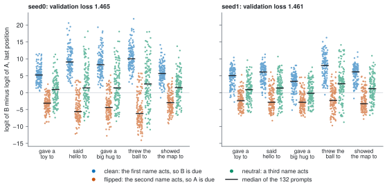
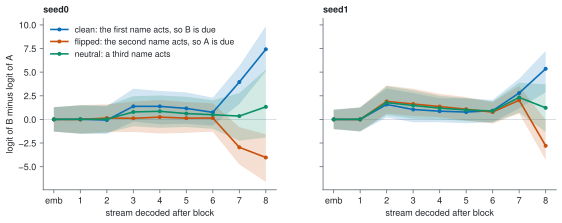
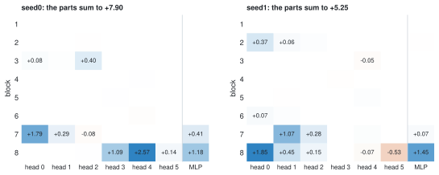
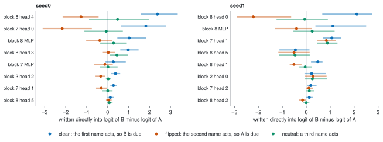

# 1. Read

Code: [`minterp/tasks.py`](../minterp/tasks.py),
[`minterp/tap.py`](../minterp/tap.py),
[`minterp/lens.py`](../minterp/lens.py) ·
Scripts: [`scripts/behavior.py`](../scripts/behavior.py),
[`scripts/lens.py`](../scripts/lens.py) ·
Tests: [`tests/test_tasks.py`](../tests/test_tasks.py),
[`tests/test_tap.py`](../tests/test_tap.py),
[`tests/test_lens.py`](../tests/test_lens.py),
[`tests/test_read.py`](../tests/test_read.py) ·
Results: [`runs/read/`](../runs/read/)

Before anything inside a model can be explained, there has to be something
it does, and a number for how well it does it. This step fixes both. Then it
looks at where in the model the answer shows, without changing anything.
Looking is the weakest kind of evidence in this walk-through, and the note
ends with what it cannot show.

## The task

    One day, Lily and Tom were playing in the garden. Lily said hello to

Two names are introduced, one of them acts, and the text stops where a
receiver is due. A reader expects the other name. The task is a small
relative of indirect object identification, which Wang et al. (2023) took
apart in GPT-2 small.

[`tasks.py`](../minterp/tasks.py) builds the prompts: 12 names that are one
token each, every ordered pair of them, in five sentence patterns, which
makes 660 prompts. Each begins with the token that opens every story in the
training data. A first check on one model tried two of the patterns and
another wording of a third; two more were added before the full run, and
none was dropped or changed for its result. Every prompt comes in three
versions that differ in one token, the name that acts:

| Version | Who acts | Which name is due |
|---|---|---|
| clean | A, the first name | B |
| flipped | B, the second name | A |
| neutral | C, a third name, taken in turn from the other ten | neither more than the other |

The measure is the logit of B minus the logit of A at the last position,
in all three versions. On the clean prompts this is the logit difference of
Wang et al., the right name minus the wrong one. On the flipped prompts the
right name is A, so a negative number is the right answer there. A
difference of 2.3 means the model holds B ten times as likely as A.

The measure asks less than "does the model say B". On the pattern that
ends in "showed the map to", the first model puts B above A in 99% of the
clean prompts, and B is its likeliest next token in 17% of them: it mostly
continues with " his" or " her". A logit difference compares two tokens and
is silent about every other one.

## Does the model do it

```sh
uv run scripts/behavior.py
uv run scripts/behavior.py --model seed1
```

Two models are measured throughout: the story model of minllm's stage 3
(seed0) and a second one trained by the same recipe with another seed
(seed1). Their validation losses are 1.465 and 1.461. On the prompt above,
" Tom" is the likeliest next token of both, with probability 0.99 and 0.79.



| Over all 660 prompts | seed0 | seed1 |
|---|---|---|
| clean: B above A | 99.8% of prompts | 95.5% |
| flipped: A above B | 84.5% | 75.8% |
| clean, median difference | +7.42 | +5.36 |
| flipped, median difference | −4.03 | −2.79 |
| neutral, mean difference | +1.84 | +1.28 |
| neutral: B above A | 59.4% | 62.7% |
| clean minus flipped, mean | 11.84 | 7.49 |

In every pattern the right name is above the wrong one in most prompts.
On the clean prompts that is 99% to 100% of a pattern's prompts in seed0
and 86% to 99% in seed1; on the flipped ones 82% to 88% and 67% to 84%.

The neutral version shows that the number mixes two things. When a third
name acts, neither A nor B is due more than the other, and both models
still lean to B, the name mentioned later: by 1.84 and 1.28 logits on
average, with B above A in about six prompts of ten. A lean of that kind
adds to the clean difference and takes from the flipped one, and the
flipped prompts are indeed the harder ones. That the lean is the reason is
this note's reading, not something measured here.

The part of the behavior that follows the acting name is the difference
between the clean and the flipped version of the same prompt. It is above
zero in 99.8% of the prompts of seed0 and 99.2% of seed1. This way of
splitting the behavior in two is also the note's own; the later steps test
it.

## Hooks

Every block adds two things to one vector per token, the residual stream:

    x = embed(tokens)
    for each block:  x = x + attention(norm(x));  x = x + mlp(norm(x))
    logits = lm_head(norm(x))

[`tap.py`](../minterp/tap.py) records these pieces during a forward pass
with PyTorch's hooks, so nothing in minllm's model code changes: the stream
after the embedding and after every block, what each attention and each MLP
added, and each head's output before the block's output projection mixes
the heads. The tests check that recording changes no logit, that the stream
after a block is the stream before it plus the two additions, that the
heads' writes sum to the attention's, and that no hook is left behind.

## The stream decoded after every block

```sh
uv run scripts/lens.py
uv run scripts/lens.py --model seed1
```

The model turns its final stream into logits with one normalization and its
output matrix. The same two can be applied to the stream after any earlier
block, as if the model stopped there. This is the logit lens
(nostalgebraist, 2020).



Median over the 660 prompts, after each block:

| | emb | 1 | 2 | 3 | 4 | 5 | 6 | 7 | 8 |
|---|---|---|---|---|---|---|---|---|---|
| seed0 clean | 0.00 | +0.01 | −0.07 | +1.38 | +1.38 | +1.16 | +0.74 | +3.95 | +7.42 |
| seed0 flipped | 0.00 | −0.01 | +0.15 | +0.12 | +0.24 | +0.13 | +0.14 | −2.96 | −4.03 |
| seed0 neutral | 0.00 | +0.01 | +0.03 | +0.79 | +0.86 | +0.62 | +0.50 | +0.35 | +1.33 |
| seed1 clean | 0.00 | 0.00 | +1.58 | +1.05 | +0.87 | +0.78 | +0.93 | +2.79 | +5.36 |
| seed1 flipped | 0.00 | −0.01 | +1.91 | +1.63 | +1.36 | +1.08 | +0.77 | +2.03 | −2.79 |
| seed1 neutral | 0.00 | +0.01 | +1.77 | +1.48 | +1.19 | +0.99 | +0.89 | +2.33 | +1.23 |

In seed0 a first step comes at block 3. It is partly a lean to B and
partly a response to the acting name: the clean prompts rise to +1.38, the
neutral ones to +0.79, and the flipped ones stay near zero. The large
movement, in both directions, comes in blocks 7 and 8.

In seed1 the first step comes at block 2 and is a lean to B alone: all
three versions rise together, by 1.6 to 1.9. The versions come apart in
block 8, where the flipped prompts fall from +2.03 to −2.79.

The medians of three groups hide something that the pairs show. Before the
versions come apart, the stream leans slightly towards the name that acts,
which is the wrong way. In seed1 the clean prompt decodes above its flipped
twin in only 12%, 1%, 2% and 17% of the pairs after blocks 2 to 5. In seed0
the same holds after block 2, in 7% of the pairs, and turns around at block
3, where it is 92%.

Two cautions about reading these numbers.

**The lens rescales.** The normalization divides the stream by its own
size, and the stream grows with depth: its root mean square at the last
position is 0.05 after the embedding, 1.10 after block 3 and 3.46 at the
end in seed0. The lens reads every depth at full size. So the fall from
+1.38 to +0.74 over blocks 4 to 6 is not something being taken away. Those
blocks write almost nothing into the difference, as the next section shows,
and the stream around it grows. The band at the embedding in the figure has
the same cause. There the stream is the embedding of " to" alone, very
small, and the lens magnifies it. Every pair of names occurs in both
orders, so the band is centred on zero.

**The lens assumes a shared language.** It decodes an early stream with
the output matrix, as if the early stream were already written in the terms
of the final one. Belrose et al. (2023) found the lens unreliable on models
such as BLOOM and GPT-Neo, and give a reason: a feature may be represented
differently at different depths. So a zero in the table says that the
output matrix reads nothing there, not that the stream holds nothing.

## What each part wrote

The final stream is a sum: the embedding, plus what every head and every
MLP added. The logit difference is, up to the final normalization, a dot
product of that stream with one fixed direction, the row of B minus the row
of A in the output matrix. A dot product with a sum is the sum of the dot
products, so every part gets a number, and the numbers add up to the logit
difference. Elhage et al. (2021) describe the stream as such a sum, and
expand the logits into terms of this kind for models made of attention
only, leaving the normalization aside.

The normalization divides the stream by its own size.
[`lens.attribute`](../minterp/lens.py) computes that size once, from the
whole final stream, and holds it fixed. The split is then exact for the
forward pass that ran: a test checks the sum against the logit difference
on a model with random weights, and the script checks it on every prompt.
Unlike the lens, these numbers are all on the scale of the final stream.



What each block writes into B minus A, mean over the prompts. Blocks that
write less than 0.12 in every version are left out:

| | seed0 clean | flipped | neutral | seed1 clean | flipped | neutral |
|---|---|---|---|---|---|---|
| block 2 | −0.02 | +0.04 | +0.01 | +0.45 | +0.52 | +0.50 |
| block 3 | +0.49 | +0.04 | +0.28 | −0.05 | +0.05 | 0.00 |
| block 7 | +2.42 | −2.36 | 0.00 | +1.45 | +1.08 | +1.17 |
| block 8 | +5.00 | −1.69 | +1.53 | +3.29 | −3.75 | −0.37 |
| the mean difference | +7.90 | −3.93 | +1.84 | +5.25 | −2.24 | +1.28 |

On the clean prompts of seed0, blocks 7 and 8 write +7.42 of the mean
difference of +7.90, and blocks 1 to 6 write +0.48. In seed1 they write
+4.74 of +5.25.

The three versions show how the two models divide the work. In seed1 the
lean to B and the response to the acting name sit in different blocks.
Blocks 2 and 7 write about the same for B whoever acts. Block 8 follows the
acting name, +3.29 against −3.75, which is 7.04 of the 7.49 between the
clean and the flipped prompts. In seed0 they are not separate. Block 7
follows the acting name and writes nothing when a third name acts. Block 8
does both: it follows the acting name and leans to B by +1.53.

The same is visible in single parts. The numbers are means of what a part
writes into B minus A:

| Model | Part | clean | flipped | neutral |
|---|---|---|---|---|
| seed0 | block 7, head 0 | +1.79 | −2.08 | −0.12 |
| seed0 | block 8, head 4 | +2.57 | −1.23 | +0.56 |
| seed0 | block 8, MLP | +1.18 | −0.51 | +0.32 |
| seed0 | block 8, head 3 | +1.09 | +0.06 | +0.57 |
| seed1 | block 8, head 0 | +1.85 | −1.95 | −0.10 |
| seed1 | block 8, MLP | +1.45 | −0.52 | +0.37 |
| seed1 | block 7, head 1 | +1.07 | +0.87 | +0.91 |
| seed1 | block 2, head 0 | +0.37 | +0.39 | +0.39 |
| seed1 | block 8, head 5 | −0.53 | −0.56 | −0.53 |



Head 0 of block 7 in seed0 and head 0 of block 8 in seed1 change sign with
the acting name and write close to nothing when a third name acts. In seed1
three heads write about the same on average in every version, two for B and
one for A. The average hides a wide spread: head 5 of block 8 writes between
−1.12 and +0.13 in the middle half of the clean prompts. Seed0 has no part
of that kind among those that write more than 0.15. Its lean to B is
written by parts that also respond to the acting name, such as heads 4 and
3 of block 8.

## The same in both models, and not

The same: blocks 7 and 8 write most of the clean difference; a few heads
and the last MLP write most of that; and in each model some heads change
sign with the acting name and write close to nothing for a third name. Not
the same:
which heads these are, where the first step comes (block 3 or block 2), and
how the lean to B is carried. Seed1 has parts that only lean, in blocks 2
and 7, and leaves the response to the acting name to block 8. Seed0 mixes
the two in the same parts.

## What this does not show

- **That the parts which write the answer compute it.** A head in block 8
  writes B or A at the last position, where neither name stands. It has to
  get the names from where they stand, and which of them acts from
  somewhere. Whether it fetches them itself or earlier blocks prepare them
  is not visible in what it writes. Blocks 1 to 6 write +0.48 directly on
  the clean prompts of seed0, and that number says nothing about how much
  the last two blocks depend on them.
- **What happens without a part.** A part's number is what it wrote into
  the answer in this pass. Without the part the stream's size would change,
  and later parts that read it would write something else.
- **That nothing is there where the lens reads zero.** The answer may be
  in the stream in a form the output matrix does not read.

Step 2 starts from the last point: where can the answer be read out, by a
reader trained for each place?

## Exercises

1. Add a sixth pattern to `TEMPLATES`, and a name. Does the model still do
   the task? If a name is dropped by `tasks.names`, why?
2. Run both scripts on a model you trained (`--model path/to/ckpt.pt`).
   Which parts write the answer in yours, and does your model keep the lean
   to B apart from the response to the acting name?
3. `lens.attribute` takes a `position`. What does the model predict right
   after the second "Lily", and which parts write it?
4. The attribution splits a logit difference. Try to split the probability
   of B the same way. Why do the parts no longer add up?
5. In seed1, head 5 of block 8 writes about −0.5 on average in every
   version. Make a guess about what it does, and say what measurement would
   test the guess.
6. Divide the lens by the ratio of the final stream's size to the size at
   each depth (`size` in the results). How close does it come to the sum of
   the direct writes up to that block, and why is it not the same?

## References

- Wang, Variengien, Conmy, Shlegeris and Steinhardt (2023), [Interpretability in the Wild: a Circuit for Indirect Object Identification in GPT-2 small](https://arxiv.org/abs/2211.00593), ICLR 2023. The task this one is modeled on, and the logit difference between the two names as a measure, beside the probability of the right name. They explain the task in GPT-2 small with a circuit of 26 attention heads.
- nostalgebraist (2020), [interpreting GPT: the logit lens](https://www.lesswrong.com/posts/AcKRB8wDpdaN6v6ru/interpreting-gpt-the-logit-lens), LessWrong. Decoding the stream at every depth with the model's own output matrix.
- Belrose et al. (2023), [Eliciting Latent Predictions from Transformers with the Tuned Lens](https://arxiv.org/abs/2303.08112). Where the logit lens fails, and a reader trained per block in its place.
- Elhage et al. (2021), [A Mathematical Framework for Transformer Circuits](https://transformer-circuits.pub/2021/framework/index.html), Transformer Circuits Thread. The stream as the sum of what every layer wrote, and, for attention-only models without normalization, the logits as a sum of terms.
- Eldan and Li (2023), [TinyStories: How Small Can Language Models Be and Still Speak Coherent English?](https://arxiv.org/abs/2305.07759). The stories the model was trained on.
