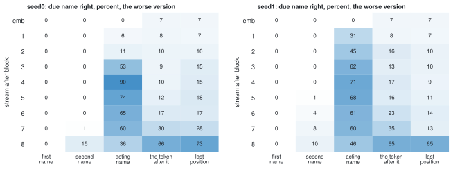
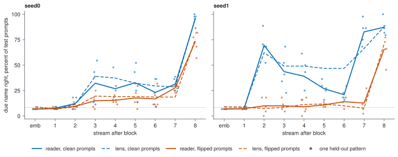
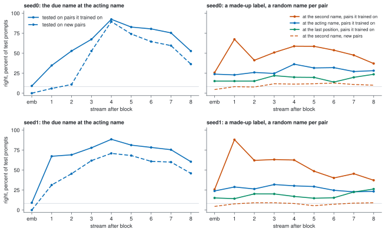

# 2. Probe

Code: [`minterp/probe.py`](../minterp/probe.py) ·
Script: [`scripts/probe.py`](../scripts/probe.py) ·
Tests: [`tests/test_probe.py`](../tests/test_probe.py),
[`tests/test_probed.py`](../tests/test_probed.py) ·
Results: [`runs/probe/`](../runs/probe/)

[Step 1](01-read.md) read the stream with the model's own output matrix and
ended on a doubt: where that reading shows nothing, the answer may still be
there in another form. A probe can settle such a doubt in one direction. It
is a reader trained for one place in the model, and if it can tell the
answer from the stream there, the answer is there to be read.

This step asks where the name that is due can be read out. It then spends
as much effort on what a reader's score does not mean, because a trained
reader can be right for reasons that have nothing to do with the model.

## A reader for one place

Alain and Bengio (2016) called them probes: linear classifiers on a
network's intermediate layers, trained apart from the network itself.
Theirs are trained with a cross-entropy loss.
[`probe.py`](../minterp/probe.py) uses the plainest linear reader that
gives the same weights on every run: a linear map from the stream to
one-hot labels, fitted by least squares with a ridge penalty, which has a
closed form.

    W = (X'X + n * lam * I)^-1 X'Y        scores = X W + mean(Y)

A place is a depth and a position. There are nine depths, after the
embedding and after each block, and five positions named by their role in
the prompt, since the sentence patterns differ in length: the first name
(A), the second (B), the acting name (S), the token after it, and the last
position. Each reader predicts one property of the prompt, a name out of
twelve:

| Property | On a clean prompt | On a flipped prompt |
|---|---|---|
| due | B | A |
| acts | A | B |
| first | A | A |
| second | B | B |

Three choices decide what the scores mean.

**What is held out.** A reader is fitted on four sentence patterns and
tested on the fifth, each pattern in turn. It is also tested only on pairs
of names it never saw together: 22 of the 66 pairs are kept out of
training, in both orders. For each held-out pattern that makes 704
training rows and 88 test rows, a row being one version of one prompt. A
score in this note says how often a linear map gets the property right on a
new sentence pattern and new pairs of names. The words "can be read" are
shorthand for a high score of that kind, and the numbers are always given.

**Scores by version.** Clean and flipped prompts are scored apart. A reader
that always says "the second name" is right on every clean prompt and wrong
on every flipped one, and step 1 found that lean in both models.

**No tuning on the test rows.** The stream is standardized with the mean
and spread of the training rows, because at the last position its size
grows about seventy-fold with depth. The ridge strength is chosen among
seven values from 0.001 to 1000 by leaving one training pattern out in
turn. A first run used a grid that stopped at 10 and chose 10 nearly
everywhere at the last position, so the grid was lengthened before any
number here was taken. The left-out pattern holds the same pairs as the
rest of the training rows, so the strength is tuned for a new pattern and
not for new pairs. A reader tuned for both might score somewhat higher.

```sh
uv run scripts/probe.py
uv run scripts/probe.py --model seed1
```

## Two checks that come free

The task offers two places where the best possible score is known in
advance. A reader that beats it is not reading what it is thought to read:
a wrong position, labels shifted against the rows, or a stream that depends
on later tokens.

- After the embedding, the stream at the last position is the token " to"
  in every prompt. With nothing to go on, a reader names the commonest name
  of its training rows, which is the due name in 3 of the 44 test pairs.
  All four properties are read at 7% there, in both models.
- Before the acting name, the clean and the flipped prompt are the same
  tokens, and the due name differs between them. So no reader can be right
  on more than half of the two versions together. At the first and the
  second name the due name is read at 50% or less of the two together, at
  every depth in both models. At the first name after block 1 it is wrong
  on every clean prompt and right on every flipped one: the reader says the
  name it stands on.

A blind guess among twelve names is right 8% of the time, but that is not
the floor everywhere. The split leaves some names more often in training
than in testing, and at a place that holds one name only, the reader names
a partner it has seen with that name, which by construction is never the
partner in a test pair. That is why the acting name after the embedding
scores 0% below.

## Where the due name can be read



At the last position and at the acting name, percent of test rows right,
mean over the five held-out patterns:

| | emb | 1 | 2 | 3 | 4 | 5 | 6 | 7 | 8 |
|---|---|---|---|---|---|---|---|---|---|
| seed0, last position, clean | 7 | 8 | 12 | 32 | 27 | 33 | 23 | 31 | 95 |
| seed0, last position, flipped | 7 | 7 | 10 | 15 | 15 | 18 | 17 | 28 | 73 |
| seed0, acting name, clean | 0 | 6 | 11 | 53 | 95 | 80 | 68 | 60 | 40 |
| seed0, acting name, flipped | 0 | 6 | 11 | 58 | 90 | 74 | 65 | 60 | 36 |
| seed1, last position, clean | 7 | 7 | 70 | 44 | 39 | 27 | 21 | 83 | 87 |
| seed1, last position, flipped | 7 | 7 | 10 | 10 | 9 | 11 | 14 | 13 | 65 |
| seed1, acting name, clean | 0 | 31 | 60 | 76 | 80 | 69 | 67 | 66 | 51 |
| seed1, acting name, flipped | 0 | 36 | 45 | 62 | 71 | 68 | 61 | 60 | 46 |

**At the last position the due name is read well on both versions only
after the final block.** In seed0 the reader is right on 31% and 28% of the
rows after block 7, and on 95% and 73% after block 8. In seed1 the flipped
rows stay at 14% or below through block 7 and reach 65% after block 8.

**At the acting name it is read well blocks earlier.** After block 4 the
reader there is right on 95% and 90% of the rows in seed0 and on 80% and
71% in seed1. After that the scores fall, to 40% and 36%, and to 51% and
46%, by the last block. The patterns differ: after block 4 the ten scores,
five held-out patterns in two versions, run from 77% to 100% in seed0 and
from 48% to 95% in seed1.

**Seed1's clean rows show why the versions are scored apart.** After block
2 the reader at the last position is right on 70% of the clean rows and 10%
of the flipped ones. That is what a reader of the second name would score,
since the second name is the due name on a clean prompt only, and the
reader trained for the second name does score 69% and 74% at that place.
Pooled, the same numbers would show 40%, which describes neither version.

## The reader against the lens



On the same test rows, how often does the lens of step 1 rank the due name
first among the twelve?

| Last position | emb | 1 | 2 | 3 | 4 | 5 | 6 | 7 | 8 |
|---|---|---|---|---|---|---|---|---|---|
| seed0, lens, clean | 9 | 7 | 11 | 39 | 37 | 32 | 30 | 29 | 96 |
| seed0, lens, flipped | 9 | 7 | 9 | 20 | 19 | 19 | 19 | 19 | 75 |
| seed1, lens, clean | 9 | 9 | 62 | 49 | 49 | 47 | 47 | 66 | 88 |
| seed1, lens, flipped | 9 | 9 | 7 | 9 | 11 | 12 | 10 | 8 | 70 |

On new pairs this reader finds no more at the last position than the lens
did. Before the last block there are 28 comparisons, two models by two
versions by seven depths. The reader is ahead of the lens in 13 of them and
behind in 15, and on average it is 1.4 points behind in seed0 and 2.2 in
seed1. That narrows the doubt step 1 ended on. It does not remove it: this
is one kind of reader under one rule, and after the final block, where the
answer is known to be there, it is still slightly behind the lens in all
four rows.

This also sharpens step 1. There, the logit difference between the two
names had moved well away from zero after block 7 of seed0. Here, at that
depth, the lens ranks the due name first among the twelve on 29% of the
clean rows and 19% of the flipped ones. A difference between two names can
open without the right name being on top.

Other properties are read better at the last position before the final
block, and not the same one in the two models:

| Last position | emb | 1 | 2 | 3 | 4 | 5 | 6 | 7 | 8 |
|---|---|---|---|---|---|---|---|---|---|
| seed0, the acting name, clean | 7 | 9 | 8 | 65 | 52 | 48 | 28 | 57 | 50 |
| seed0, the acting name, flipped | 7 | 9 | 7 | 70 | 59 | 50 | 27 | 55 | 60 |
| seed1, the second name, clean | 7 | 8 | 69 | 47 | 38 | 33 | 23 | 94 | 87 |
| seed1, the second name, flipped | 7 | 8 | 74 | 51 | 42 | 35 | 31 | 89 | 81 |

In seed0 the acting name is read best after block 3, and in seed1 the
second name after blocks 2 and 7. Step 1 saw writes into the logit
difference at the same blocks: in seed0 a first step at block 3, partly a
response to the acting name, and in seed1 a lean to the second name at
blocks 2 and 7. A name that can be read and a logit difference that moves
are different measurements, so that they line up is this note's reading and
no more.

## What a score does not mean

### The reader may be doing the work

The due name is fixed by three tokens: it is one of the two names, and not
the one that acts. Can a linear map work that out by itself? The script
tries it with no model at all. The input is only the identity of the first
name, the second name and the acting name, as three one-hot vectors. The
reader and the held-out pairs are the same as above; there are no sentence
patterns here, so it trains on 176 rows.

| Input | Due name right |
|---|---|
| first, second and acting name | 100% of clean rows, 100% of flipped rows |
| first and second name | 50% of the two versions together: the two names tie |

So a linear map can produce the due name from the three identities when
each comes in a code of its own. A score of 95% at the acting name
therefore does not show that the model has worked out the due name there.
It may show only that the stream holds the three ingredients. This is the
question Hewitt and Liang (2019) put to probes of language models: does a
high score mean that the representation encodes the structure, "or just
that the probe has learned the linguistic task?"

### The reader may be remembering

Hewitt and Liang's test is a control task: give every word type a random
output, the same wherever the word occurs, and see how well the probe
learns it. A probe that scores well on the control is remembering its
training data. They call the gap between the score on the real task and the
score on the control the probe's selectivity.

The control here is a random name drawn once for every ordered pair of
names. It is a function of the pair and of nothing else, so a reader can
only get it right for pairs it was trained on. It is scored under a second
rule, where the test pattern is still new and the pairs are not.



| Made-up label, percent right | seed0 | seed1 |
|---|---|---|
| always naming the commonest label, pairs it trained on | 15 | 15 |
| at the second name after block 1, pairs it trained on | 67 | 88 |
| at the second name after blocks 2 to 8, pairs it trained on | 37 to 59 | 37 to 63 |
| at the last position, pairs it trained on, by depth | 14 to 24 | 14 to 26 |
| at any of the 45 places, new pairs | 5 to 15 | 5 to 14 |

At the second name, a reader tested on pairs it has seen gets a label right
that it could only have remembered, far more often than a constant guess
would. At the last position it barely does.

The real property is inflated in the same way where the pairs can be
remembered. At the acting name after block 2, the due name is read at 53%
and 60% in seed0 on pairs the reader trained on, against 11% on new pairs,
and at 79% and 69% in seed1, against 60% and 45%. After block 4 of seed0
the two rules agree within three points. The two rules also differ in how
many rows they train on, 1,056 against 704, so not all of the gap is
memory.

Every number outside this section is from new pairs. There the made-up
label is read at 5% to 15% across all places, around the 11% that always
naming the commonest label gives.

### Readable is not used

None of this says that the model takes the due name from where it can be
read. Elazar et al. (2021) removed the linearly readable part of a property
from the representations of BERT and watched the model's predictions.
Across the properties they tested, how well a property could be probed was
not correlated with how much the model's predictions depended on it. That
kind of test, changing the stream and watching the answer, is step 3.

## The same in both models, and not

The same, with both versions asked: the due name is read well at the acting
name by block 4 and at the last position only after block 8; on new pairs
the trained reader finds no more at the last position than the lens; and a
reader tested on pairs it trained on scores far above a constant guess on a
made-up label at the second name. Not the same: what else is read at the
last position before the final block. In seed0 it is the acting name, best
after block 3. In seed1 it is the second name, after blocks 2 and 7.

## What this does not show

- **That the model uses what can be read.** The due name is read well at
  the acting name blocks before it is read well where it is needed. Whether
  the last block takes it from there is not a question a reader can answer.
- **That the due name is worked out where it is read.** A linear map
  produces it from the three tokens' identities alone.
- **That nothing is there where the reader fails.** The reader is linear,
  fitted by least squares on 704 rows, and has to carry over to a new
  sentence pattern and to new pairs. A property may be in the stream in a
  form that such a reader misses. On pairs it trained on, the same reader is
  ahead of the lens at the last position in 20 of the 28 comparisons, which
  may be memory and may be something a better reader would find.

Step 3 starts from the first point: put a piece of one prompt's stream into
another prompt's run, and see whether the answer follows.

## Exercises

1. The results hold `composite`: the due name read by adding the scores of
   the readers for the first and the second name and subtracting those for
   the acting name, with no reader trained on the due name. At the acting
   name after block 4 of seed0 it scores well below the trained reader.
   What would you conclude from the gap, and what not?
2. Replace least squares by logistic regression. Do the scores at the
   acting name after block 4 change? What do you have to fix so that two
   runs agree?
3. A reader needs no fitting if each name's direction is the mean of the
   stream over the rows where that name is due, minus the mean over all
   rows. How well does it read?
4. Fit the readers on clean rows only and test them on flipped ones. Which
   properties survive, and at which positions?
5. In seed1 the scores at the acting name differ a great deal between
   held-out patterns. Which pattern is the hard one, and is it also the
   pattern where the model itself does worst in step 1?
6. Choose the ridge strength by leaving pairs out as well as a pattern. Do
   the scores on new pairs rise?

## References

- Alain and Bengio (2016), [Understanding intermediate layers using linear classifier probes](https://arxiv.org/abs/1610.01644). Linear classifiers trained on a network's intermediate layers, apart from the network: the method and the name.
- Hewitt and Liang (2019), [Designing and Interpreting Probes with Control Tasks](https://arxiv.org/abs/1909.03368), EMNLP 2019. Control tasks, which pair word types with random outputs, and selectivity, the gap between a probe's accuracy on the real task and on the control. They report that popular probes of ELMo are not selective.
- Elazar, Ravfogel, Jacovi and Goldberg (2021), [Amnesic Probing: Behavioral Explanation with Amnesic Counterfactuals](https://arxiv.org/abs/2006.00995), TACL 9. Removing a property from the representation to see whether the model needs it. On BERT they find that probing accuracy does not correlate with the property's importance for the task.
