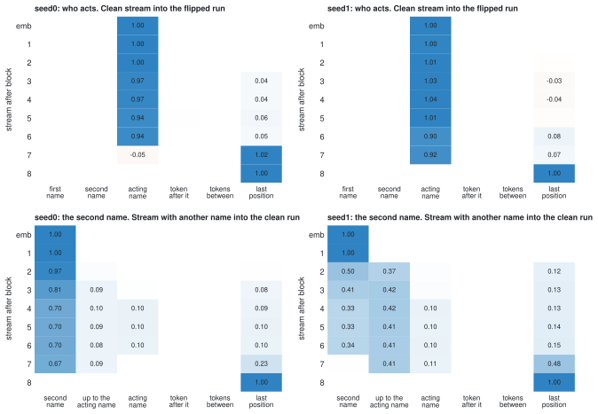
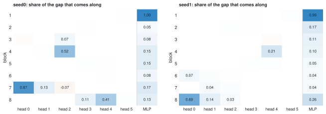
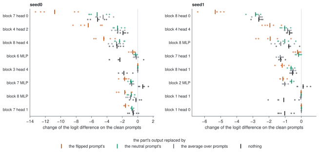

# 3. Patch

Code: [`minterp/patch.py`](../minterp/patch.py) ·
Script: [`scripts/patch.py`](../scripts/patch.py) ·
Tests: [`tests/test_patch.py`](../tests/test_patch.py),
[`tests/test_patched.py`](../tests/test_patched.py) ·
Results: [`runs/patch/`](../runs/patch/)

Steps [1](01-read.md) and [2](02-probe.md) looked at a run and left it
alone, and step 2 ended on the limit of looking: what can be read at a
place need not be what the model uses. This step changes the run. It puts a
piece of one prompt's computation into another prompt's and watches the
answer. If the answer follows the piece, the answer depends on that place.

## The intervention

Record the activations of a source prompt. Run a target prompt, and at one
place put the source's activation where the target's own would be.
Everything after that place computes on as usual.

```python
source, _ = patch.record(model, batch.clean)
at = [batch.pos["S"]]  # the acting name
logits = patch.run(model, batch.flipped, {("resid", 6): patch.swap(source["resid", 6], positions=at)})
```

The two prompts have to line up token by token. The versions of the task
were built for that: they differ in one token.

A patch is scored by how far it moves a measure from the target run's value
towards the source run's: 0 is not at all, 1 is all the way. The measure is
the logit difference of step 1 unless another is named. The share is taken
on the means over a pattern's 132 prompts, because a ratio per prompt blows
up wherever the two runs happen to agree. The tables give the mean of the
five patterns.

The idea is older than its use here. Vig et al. (2020) cast causal
mediation analysis as a way to analyze language models, and Meng et al.
(2022) traced facts through GPT with three runs: a clean one, one with the
subject corrupted, and one that restores selected activations to their
clean values. Heimersheim and Nanda (2024) name the two directions a patch
can go. Denoising puts clean activations into the corrupted run and shows
which are sufficient to restore the behavior. Noising puts corrupted ones
into the clean run and shows which were necessary to maintain it. They
stress that the two can be very different. This note calls them carry and
break:

| | Source | Target | Asks |
|---|---|---|---|
| carry | clean | flipped | does the clean answer come along with this piece? |
| break | flipped | clean | does the clean answer go without it? |

```sh
uv run scripts/patch.py
uv run scripts/patch.py --model seed1
```

## Three checks that come free

Some shares are fixed by how a transformer is built, whatever its weights.
A patching script that gets them wrong has a bug.

- The clean and the flipped prompt are the same tokens up to the acting
  name, so their streams are equal there, and a patch at any earlier
  position must change nothing. The shares there are 0.00 at every depth in
  both models.
- The stream at one depth, at all positions, is everything the later
  blocks see. Moving all of it must move the whole answer. The share is 1.00
  at every depth in both models.
- After the embedding only the changed token's position differs, and after
  the last block only the last position reaches the answer. So in the two
  tables below whose columns are depths, the first and the last column read
  1.00 at one position and 0.00 elsewhere for any model. What a model can
  differ in is the columns between. For the same reason a part of the final
  block can act at the last position only.

## Where "who acts" is



The stream at one depth and one position, moved from the clean prompt into
the flipped run. Positions that are not listed carry nothing: the first and
second name, the token after the acting name and the tokens up to the last
one are all within 0.01 of zero.

| carry | emb | 1 | 2 | 3 | 4 | 5 | 6 | 7 | 8 |
|---|---|---|---|---|---|---|---|---|---|
| seed0, at the acting name | 1.00 | 1.00 | 1.00 | 0.97 | 0.97 | 0.94 | 0.94 | −0.05 | 0.00 |
| seed0, at the last position | 0.00 | 0.00 | 0.00 | 0.04 | 0.04 | 0.06 | 0.05 | 1.02 | 1.00 |
| seed1, at the acting name | 1.00 | 1.00 | 1.01 | 1.03 | 1.04 | 1.01 | 0.90 | 0.92 | 0.00 |
| seed1, at the last position | 0.00 | 0.00 | −0.01 | −0.03 | −0.04 | −0.02 | 0.08 | 0.07 | 1.00 |

For the part of the behavior that follows the acting name, the answer
depends almost entirely on one position at a time. Through block 6 of seed0
the acting name's position carries 0.94 or more of the gap (0.90 to 0.97
over the five patterns after block 6). After block 7 it carries −0.05 and
the last position 1.02: block 7 moves it. In seed1 the acting name's
position still carries 0.92 after block 7, so the move is left to the final
block. Break gives the same picture, within 0.03 of carry in every cell of
the table.

"Almost" covers a second, small route. In seed0 the last position carries
0.04 to 0.06 from block 3 on, the block where step 1 saw a first step that
responds to the acting name. In seed1 it carries 0.08 and 0.07 after blocks
6 and 7.

Step 2 could read the acting name at the last position of seed0 on 65% and
70% of its test rows after block 3. Here that position carries 0.04 of the
gap at that depth. A reader could tell who acts from it four blocks before
the answer came to depend on it.

## Where the names are

Who acts is one of the things the answer needs. The other is the names
themselves. Two more versions of the task change a name and nothing else.
`other` is the clean prompt with a third name C in place of B, and
`other_first` is the flipped prompt with C in place of A. In both, C is
due. The stream of each is moved into the run it was made from, and the
measure is the logit of C minus the logit of the name it replaced, which
goes from −7.99 to +7.97 for the second name in seed0 and from −5.80 to
+5.69 for the first.

| Share of the way to C | emb | 1 | 2 | 3 | 4 | 5 | 6 | 7 | 8 |
|---|---|---|---|---|---|---|---|---|---|
| seed0, second name: at its own position | 1.00 | 1.00 | 0.97 | 0.81 | 0.70 | 0.70 | 0.70 | 0.67 | 0.00 |
| seed0, second name: between it and the acting name | 0.00 | 0.00 | 0.03 | 0.09 | 0.10 | 0.09 | 0.08 | 0.09 | 0.00 |
| seed0, second name: at the acting name | 0.00 | 0.00 | 0.00 | 0.01 | 0.10 | 0.10 | 0.10 | 0.00 | 0.00 |
| seed0, second name: at the last position | 0.00 | 0.00 | 0.01 | 0.08 | 0.09 | 0.10 | 0.10 | 0.23 | 1.00 |
| seed0, first name: at its own position | 1.00 | 0.99 | 0.90 | 0.61 | 0.45 | 0.45 | 0.44 | 0.42 | 0.00 |
| seed0, first name: between it and the acting name | 0.00 | 0.01 | 0.10 | 0.30 | 0.31 | 0.30 | 0.29 | 0.29 | 0.00 |
| seed0, first name: at the acting name | 0.00 | 0.00 | 0.00 | 0.03 | 0.14 | 0.15 | 0.15 | 0.00 | 0.00 |
| seed0, first name: at the last position | 0.00 | 0.00 | 0.01 | 0.05 | 0.07 | 0.08 | 0.09 | 0.27 | 1.00 |
| seed1, second name: at its own position | 1.00 | 1.00 | 0.50 | 0.41 | 0.33 | 0.33 | 0.34 | −0.01 | 0.00 |
| seed1, second name: between it and the acting name | 0.00 | 0.00 | 0.37 | 0.42 | 0.42 | 0.41 | 0.41 | 0.41 | 0.00 |
| seed1, second name: at the acting name | 0.00 | 0.00 | 0.01 | 0.03 | 0.10 | 0.10 | 0.10 | 0.11 | 0.00 |
| seed1, second name: at the last position | 0.00 | 0.00 | 0.12 | 0.13 | 0.13 | 0.14 | 0.15 | 0.48 | 1.00 |
| seed1, first name: at its own position | 1.00 | 0.98 | 0.42 | 0.30 | 0.20 | 0.19 | 0.19 | 0.00 | 0.00 |
| seed1, first name: between it and the acting name | 0.00 | 0.02 | 0.52 | 0.61 | 0.61 | 0.60 | 0.59 | 0.66 | 0.00 |
| seed1, first name: at the acting name | 0.00 | 0.00 | 0.01 | 0.03 | 0.12 | 0.13 | 0.12 | 0.12 | 0.00 |
| seed1, first name: at the last position | 0.00 | 0.00 | 0.05 | 0.06 | 0.06 | 0.08 | 0.09 | 0.21 | 1.00 |

The token after the acting name and the tokens up to the last one carry
0.00 and are left out. In these two experiments the shares of the groups
add up to between 0.98 and 1.00 at every depth, so here a share can be read
as a fraction.

The models keep the names in different places. In seed0 the second name
mostly stays where it stands: its own position carries 0.70 after blocks 4
to 6. The first name is split, 0.45 at its own position and 0.30 on the
tokens after it. In seed1 both names spread in block 2 to the tokens that
follow them, which then carry 0.4 of the second name and 0.6 of the first.
Seed1's last position also has 0.12 of the second name from block 2 and
0.48 after block 7, the blocks at which step 1 saw a lean to the second
name being written.

**The acting name's position carries a tenth to a seventh of a name.**
Each name was changed in the version where it is due. After blocks 4 to 6
the acting name's position carries 0.10 of the second name in both models,
and 0.14 to 0.15 of the first name in seed0 and 0.12 to 0.13 in seed1. This is
the place where the reader of step 2 got the due name right on 95% and 90%
of its test rows in seed0 after block 4, and on 80% and 71% in seed1. So
the copy of the other name that a reader finds at the acting name moves the
answer only a little. What the model does take from that position is who
acts, 0.94 and 0.90 of it after block 6. The names it takes mostly from
elsewhere.

## Which parts

The same patch, on one part at a time: the output of a head or an MLP,
moved from the clean prompt into the flipped run. The script does it at all
positions and, as further patches, at the last position only, at all
positions before it, and at the acting name only.



The rows are each model's four largest parts, and head 3 of block 8 in
seed0, which step 1 discussed. The last column is from step 1: what the part writes directly into the
logit difference on the clean prompts minus what it writes on the flipped
ones, as a share of the same gap.

| Model | Part | carry | at the last position | at the acting name | written directly |
|---|---|---|---|---|---|
| seed0 | block 1, MLP | 1.00 | 0.00 | 1.00 | 0.00 |
| seed0 | block 7, head 0 | 0.87 | 0.86 | 0.00 | 0.33 |
| seed0 | block 4, head 2 | 0.52 | 0.00 | 0.52 | 0.00 |
| seed0 | block 8, head 4 | 0.41 | 0.41 | 0.00 | 0.32 |
| seed0 | block 8, head 3 | 0.11 | 0.11 | 0.00 | 0.09 |
| seed1 | block 1, MLP | 0.99 | 0.00 | 0.99 | 0.00 |
| seed1 | block 8, head 0 | 0.69 | 0.69 | 0.00 | 0.51 |
| seed1 | block 8, MLP | 0.26 | 0.26 | 0.00 | 0.26 |
| seed1 | block 4, head 4 | 0.21 | 0.00 | 0.21 | 0.00 |

Over the five patterns, head 0 of block 7 in seed0 carries 0.83 to 0.95 and
head 0 of block 8 in seed1 carries 0.60 to 0.85.

**A head that writes nothing into the answer and matters.** Head 2 of
block 4 in seed0 and head 4 of block 4 in seed1 write 0.00 directly, and
carry 0.52 and 0.21 of the gap. They act at the acting name's position, so
whatever they do there, a later block passes it on. Step 1's reading could
not have found them.

**What a part writes directly can be less than what depends on it.** Head
0 of block 7 in seed0 writes 0.33 of the gap and carries 0.87. The last MLP
has nothing after it but the final normalization, and its two columns
agree: 0.26 and 0.26 in seed1. The heads of the last block can still act
through that MLP, and theirs are closer than block 7's but not equal: 0.32
against 0.41 and 0.09 against 0.11 in seed0, and 0.51 against 0.69 in
seed1.

**The shares do not add up to one.** Over all 56 parts they sum to 3.85 in
seed0 and 3.05 in seed1. One reason would be parts that work one after
another: each would carry what passes through it, and the same share would
be counted at every stage. The script tests this on the four largest parts
of each model besides the first MLP, moved two at a time from the clean
prompt into the flipped run. Two parts that do not overlap would carry the
sum of their shares, and two links of one chain would carry the larger
share.

A sum above one cannot be reached in any case, so the telling pairs are
those whose sum is below one. In seed0, head 2 of block 4 with head 4 of
block 8 carry 0.61 together against a sum of 0.93. In seed1, head 0 of
block 8 with the last MLP carry 0.78 against 0.95. Over the six pairs of
each model, together comes to between 0.65 and 0.89 of the sum in seed0 and
between 0.81 and 1.05 in seed1. So the largest parts overlap in both
models, more in seed0, and in neither do they form a single chain: head 2
of block 4 with head 0 of block 7 carry 0.97 together, more than the 0.87
of the larger one.

The MLP of block 1 carries all of it, at the acting name's position. Moving
it is as good as changing the acting token. The embedding of a token is
small: at the acting name it is 0.05 in root mean square in both models,
the stream after block 1 is 0.85 and 0.79, and nearly all of the growth is
what the first MLP adds. This note's reading is that the later blocks know
the token by what the first MLP makes of it. Patching finds what carries
the information. It does not tell a part that works something out from a
part that hands its input on.

Carry and break agree here. For every part the two shares differ by at most
0.07 in seed0 and 0.05 in seed1. For small parts that can still be a large
ratio: the MLP of block 4 in seed0 carries 0.15 and breaks 0.08.

## What stands in for a part

So far the stand-in for a part's output was the same part's output on
another prompt. Two other stand-ins are common: an average, and nothing at
all. The script replaces every part of the clean run in four ways and
records the change of the logit difference, in logits, as a mean over the
prompts. The average is taken position by position over the 396 runs of the
pattern: the clean, flipped and neutral versions of its 132 prompts.



A selection of parts, chosen to show how the columns can differ:

| Model | Part | flipped prompt's | neutral prompt's | average | nothing |
|---|---|---|---|---|---|
| seed0 | block 7, head 0 | −10.80 | −5.27 | −4.50 | −5.22 |
| seed0 | block 7, MLP | −1.71 | −0.90 | −0.79 | +0.66 |
| seed0 | block 6, MLP | −0.66 | −0.29 | −0.19 | −2.31 |
| seed0 | block 3, head 4 | +0.01 | 0.00 | +0.01 | −1.80 |
| seed1 | block 8, head 0 | −5.34 | −2.85 | −2.62 | −2.64 |
| seed1 | block 2, head 0 | +0.01 | +0.01 | −0.60 | −0.47 |
| seed1 | block 7, head 1 | −0.24 | −0.17 | −1.31 | −1.28 |
| seed1 | block 1, head 1 | −0.01 | −0.01 | −0.03 | −1.09 |

The four columns answer four questions, and a part can be large in one and
absent in another.

- **The flipped prompt's** output pushes towards the other answer, the
  **neutral prompt's** only takes the information away. For head 0 of block
  7 in seed0 and head 0 of block 8 in seed1 the first is about twice the
  second.
- **A part that writes the same whoever acts** shows nothing when prompts
  are swapped and shows when it is removed. Head 0 of block 2 in seed1 is
  the clean case: 0.01 against −0.60. Head 1 of block 7, the largest of the
  heads step 1 saw leaning to the second name, changes the answer by −0.24
  when swapped and by −1.31 when averaged. What these heads write depends
  on the names, and the average runs over prompts with other names.
- **A part that writes the same in every prompt** shows only when nothing
  stands in for it: head 4 of block 3 in seed0, head 1 of block 1 in seed1.
  Wang et al. (2023) give this as their reason for averaging in place of
  deleting: zero is an arbitrary value, and later parts may rely on a
  part's average output as on a bias term. Their average is taken over
  other prompts than the ones under study, which the one here is not.
- **The sign can turn.** The MLP of block 7 in seed0 costs 1.71 logits
  when the flipped prompt's output stands in for it, and gains 0.66 when
  nothing does.

So a sentence of the form "this part matters by so much" is incomplete
until it says what stood in for the part. Zhang and Nanda (2024) compared
two ways of making the other prompt, noise on the embeddings of key tokens
and replacing those tokens by related ones, and advocate the second because
its prompts stay within what the model was trained on. The first two
columns are of that kind.

## The same in both models, and not

The same: for who acts, the answer depends almost entirely on the acting
name's position until a late block; one head at the last position carries
most of it (0.87 and 0.69; in seed1 that head is in the final block,
where its position is no finding); a head in block 4 that writes nothing directly
carries part of it at the acting name's position (0.52 and 0.21); the first
MLP carries all of it; after blocks 4 to 6 the acting name's position
carries a tenth to a seventh of a name; and carry agrees with break within
0.07 wherever both were run. Not the same: which block moves who acts to
the last position, block 7 in seed0 and the final block in seed1; where the
names are kept; and how much the largest parts overlap, which is more in
seed0.

## What this does not show

- **What a part does.** A share says that the answer depends on a part,
  not what the part attends to or what it writes. Head 0 of block 7 could
  copy a name, suppress one, or pass on a signal that the next block turns
  into a name.
- **By which route.** A patch of a part's output reaches the answer by
  every path at once: directly, and through each later part that reads it.
  The pairs are a first look at this and no more.
- **Each prompt.** The shares are ratios of means. A part can carry the
  answer in most prompts and not in some.
- **Other stand-ins.** The shares come from two prompts that differ in one
  name. Another way of making the second prompt can give another map.

Step 4 starts from the first two points: what do the heads found here
attend to, what do they write, and which of them reads which?

## Exercises

1. Compute the share per prompt for head 0 of block 7 in seed0, leaving out
   prompts where the two runs differ by less than a logit. How wide is the
   spread, and which prompts sit at its low end?
2. The pairs of the script are moved from the clean prompt into the flipped
   run. Move them the other way. Do the parts of seed0 overlap as much?
3. Head 4 of block 3 in seed0 changes the logit difference by −1.80 when
   nothing stands in for it and by 0.01 otherwise. Use the lens of step 1
   on its output. What does it write?
4. Meng et al. corrupt a prompt by adding noise to the embeddings of the
   subject's tokens. Do that to the acting name in place of swapping it,
   and compare the map of the stream with the one above.
5. The first name of seed0 sits partly on the tokens after it. Which ones?
   Split the group and patch them one at a time.
6. Run the script on your own model. Which block moves who acts to the last
   position, and how much do your largest parts overlap?

## References

- Vig et al. (2020), [Investigating Gender Bias in Language Models Using Causal Mediation Analysis](https://arxiv.org/abs/2004.12265), NeurIPS 2020. Causal mediation analysis as a way to analyze the parts of a language model. The preprint has another title, "Causal Mediation Analysis for Interpreting Neural NLP: The Case of Gender Bias".
- Meng, Bau, Andonian and Belinkov (2022), [Locating and Editing Factual Associations in GPT](https://arxiv.org/abs/2202.05262), NeurIPS 2022. Causal tracing: a clean run, a run with the subject corrupted, and a run that restores selected activations to their clean values.
- Wang, Variengien, Conmy, Shlegeris and Steinhardt (2023), [Interpretability in the Wild: a Circuit for Indirect Object Identification in GPT-2 small](https://arxiv.org/abs/2211.00593), ICLR 2023. Knocking parts out by their average over a reference set of prompts in place of zero, and why.
- Zhang and Nanda (2024), [Towards Best Practices of Activation Patching in Language Models: Metrics and Methods](https://arxiv.org/abs/2309.16042), ICLR 2024. How the corrupted prompt and the measure change what patching finds; they advocate replacing tokens over adding noise, and the logit difference as the measure.
- Heimersheim and Nanda (2024), [How to use and interpret activation patching](https://arxiv.org/abs/2404.15255). Denoising and noising, and what each can and cannot show.
