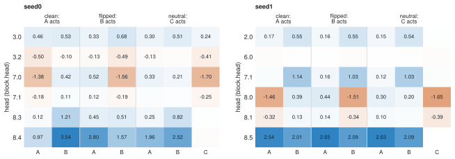
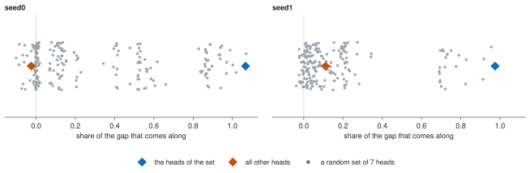

# 4. Circuit

Code: [`minterp/attention.py`](../minterp/attention.py) ·
Script: [`scripts/circuit.py`](../scripts/circuit.py) ·
Tests: [`tests/test_attention.py`](../tests/test_attention.py),
[`tests/test_circuit.py`](../tests/test_circuit.py) ·
Results: [`runs/circuit/`](../runs/circuit/)

[Step 3](03-patch.md) found which parts the answer depends on, and said
nothing about what they do. A head moves information from one position to
another, and Elhage et al. (2021) take it apart into two largely
independent things: where it reads from, and what it moves. This step asks
both of the heads that the earlier steps found, then asks which head works
through which, and then tests the set as a whole. The result is a
description of how each model does the task, and the two descriptions are
not the same.

## The heads

The heads are taken from the records of the earlier steps by a rule, not by
eye: every head that [step 3](03-patch.md) found to carry at least 0.05 of
the gap between the clean and the flipped prompt, and every head that
[step 1](01-read.md) found to write at least 0.3 logits into the logit
difference, in either direction, in some version. That gives seven heads in
each model. A head is studied at the acting name's position if step 3 found
a share of at least 0.05 there, and at the last position otherwise. Below,
4.2 means head 2 of block 4.

```sh
uv run scripts/circuit.py
uv run scripts/circuit.py --model seed1
```

## Where a head reads from

A head compares the query of the position it writes at with the keys of all
positions up to and including its own, and a softmax turns the comparison
into weights that sum to one. minllm computes attention with a library call
that does not return the weights, so
[`attention.py`](../minterp/attention.py) computes them again from the same
inputs. A test checks that the weighted sum of values built from them is
what the model's attention wrote.

The share of a head's attention that goes to the first name (A), the second
name (B), the full stop that ends the first sentence, and the acting name's
position (S), as a mean over the 660 prompts. For a head studied at the
acting name, S is its own position.

| Model | Head | at | clean: A | B | stop | S | flipped: A | B | stop | S |
|---|---|---|---|---|---|---|---|---|---|---|
| seed0 | 3.0 | last | 0.16 | 0.29 | 0.03 | 0.10 | 0.18 | 0.26 | 0.03 | 0.10 |
| seed0 | 3.2 | last | 0.13 | 0.10 | 0.03 | 0.36 | 0.14 | 0.09 | 0.03 | 0.36 |
| seed0 | 4.2 | acting name | 0.01 | 0.91 | 0.00 | 0.01 | 0.78 | 0.07 | 0.00 | 0.01 |
| seed0 | 7.0 | last | 0.02 | 0.08 | 0.01 | 0.79 | 0.02 | 0.06 | 0.01 | 0.83 |
| seed0 | 7.1 | last | 0.01 | 0.03 | 0.01 | 0.86 | 0.01 | 0.03 | 0.01 | 0.86 |
| seed0 | 8.3 | last | 0.03 | 0.67 | 0.01 | 0.02 | 0.22 | 0.23 | 0.01 | 0.06 |
| seed0 | 8.4 | last | 0.04 | 0.63 | 0.21 | 0.01 | 0.31 | 0.13 | 0.39 | 0.01 |
| seed1 | 2.0 | last | 0.08 | 0.32 | 0.09 | 0.02 | 0.08 | 0.32 | 0.09 | 0.01 |
| seed1 | 4.4 | acting name | 0.05 | 0.85 | 0.01 | 0.01 | 0.79 | 0.10 | 0.01 | 0.01 |
| seed1 | 6.0 | last | 0.01 | 0.02 | 0.04 | 0.60 | 0.01 | 0.02 | 0.04 | 0.59 |
| seed1 | 7.1 | last | 0.04 | 0.86 | 0.01 | 0.01 | 0.09 | 0.74 | 0.02 | 0.02 |
| seed1 | 8.0 | last | 0.01 | 0.05 | 0.00 | 0.93 | 0.01 | 0.03 | 0.00 | 0.96 |
| seed1 | 8.1 | last | 0.00 | 0.03 | 0.01 | 0.91 | 0.00 | 0.02 | 0.01 | 0.92 |
| seed1 | 8.5 | last | 0.00 | 0.00 | 0.89 | 0.00 | 0.00 | 0.00 | 0.92 | 0.00 |

On a clean prompt the first name acts, on a flipped one the second. By
where they read, most of the heads fall into three kinds.

- **At the acting name, reading the other name.** Head 4.2 of seed0 and
  head 4.4 of seed1 give most of their attention to the name that does not
  act: the second name on clean prompts (0.91, 0.85), the first on flipped
  ones (0.78, 0.79). On neutral prompts, where neither of the two acts,
  they split it between them (0.38 and 0.58; 0.52 and 0.43).
- **At the last position, reading the acting name's position.** Heads 7.0
  and 7.1 of seed0 and heads 8.0 and 8.1 of seed1 give it 0.79 to 0.96,
  whoever acts. Head 6.0 of seed1 gives it 0.60 and head 3.2 of seed0 0.36.
- **At the last position, reading a name.** In seed0, head 8.4 reads the
  second name on clean prompts (0.63) and the first more than the second on
  flipped ones (0.31 against 0.13). Head 8.3 reads the second name on clean
  prompts (0.67) and on flipped ones has no preference (0.22, 0.23). In
  seed1, head 7.1 reads the second name in both versions (0.86, 0.74). Heads
  2.0 of seed1 and 3.0 of seed0 give the second name about 0.3.

Two heads also read the full stop. Head 8.5 of seed1 reads little else
(0.89, 0.92), and head 8.4 of seed0 gives it 0.21 on clean prompts and 0.39
on flipped ones, more than it gives the first name.

## What a head writes

What a head adds to the stream at the last position can be decoded as in
step 1. Here it is decoded for the names of the task: what the head adds to
the logit of A, of B and of the third name C, each against the mean of the
nine names that are none of the three.



| Model | Head | clean (A acts): A | B | flipped (B acts): A | B | neutral (C acts): C |
|---|---|---|---|---|---|---|
| seed0 | 7.0 | −1.38 | +0.42 | +0.52 | −1.56 | −1.70 |
| seed0 | 3.2 | −0.50 | −0.10 | −0.13 | −0.49 | −0.41 |
| seed0 | 7.1 | −0.18 | +0.11 | +0.12 | −0.19 | −0.25 |
| seed0 | 8.4 | +0.97 | +3.54 | +2.80 | +1.57 | −0.07 |
| seed0 | 8.3 | +0.12 | +1.21 | +0.45 | +0.51 | +0.04 |
| seed0 | 3.0 | +0.46 | +0.53 | +0.33 | +0.68 | +0.24 |
| seed1 | 8.0 | −1.46 | +0.39 | +0.44 | −1.51 | −1.65 |
| seed1 | 8.1 | −0.32 | +0.13 | +0.14 | −0.34 | −0.39 |
| seed1 | 6.0 | −0.05 | +0.02 | +0.02 | −0.06 | −0.07 |
| seed1 | 7.1 | +0.07 | +1.14 | +0.16 | +1.03 | +0.05 |
| seed1 | 2.0 | +0.17 | +0.55 | +0.16 | +0.55 | +0.03 |
| seed1 | 8.5 | +2.54 | +2.01 | +2.65 | +2.09 | −0.01 |

**Every head that reads the acting name's position lowers the acting
name.** One head in each model does it strongly: head 7.0 of seed0 takes
1.38 to 1.70 logits off whichever name acts, A, B or C, and head 8.0 of
seed1 takes off 1.46 to 1.65. The others do the same by 0.5 or less. The
two strong heads also add 0.4 to 0.5 to the other name of the pair.

[Step 6](06-feature-circuit.md) looks at this again and finds it too
narrow. "Lowers the acting name" is measured against uninvolved names, and
on the clean prompts, where step 6 measured it, most of it for the six
names the model follows with "She" is all names of that kind going down,
not the acting name alone.

**The heads that read a name raise it.** The script splits a head's write
by the position it was read from. On clean prompts head 8.4 of seed0 adds
3.54 to the second name, of which 3.01 comes from that name's position. On
flipped ones it adds 2.80 to the first name: 1.48 from that name's position
and 1.25 from the full stop, from which it raises both names. Head 7.1 of
seed1 adds 1.14 and 1.03 to the second name, nearly all of it from that
name's position.

**Head 8.5 of seed1 raises both names of the pair**, by 2.0 to 2.65,
whoever acts. All of it comes from the full stop. Step 3 found that seed1
spreads the names to the tokens that follow them, and this head reads them
there.

For the rest of this note, three words: a head **fetches** when it reads
the other name at the acting name's position, **vetoes** when it reads the
acting name's position and lowers that name, and **copies** when it reads a
name and raises it. The words are this note's, and they describe what was
measured on these prompts. For the fetching heads only the reading was
measured: what they write at the acting name was not decoded.

## Which works through which

A head in a later block can depend on an earlier one. Three tests, all made
with the tools of step 3.

**Hold and relay.** Give the flipped run an earlier head's clean output,
as in step 3, and keep one later head at what it wrote in the flipped run.
What is lost went through the later head, directly or by way of something
between them. The converse test leaves the earlier head alone and gives the
later head what it wrote in that patched run: what comes along was relayed
by the later head alone. The table shows six of the eleven pairs in which
holding changes the share by 0.03 or more; the results hold the rest.

| Model | Earlier head | its share | later head | left when it is held | relayed by it alone |
|---|---|---|---|---|---|
| seed0 | 4.2 | 0.52 | 7.0 | 0.06 | 0.42 |
| seed0 | 4.2 | 0.52 | 8.4 | 0.22 | 0.32 |
| seed0 | 4.2 | 0.52 | 8.3 | 0.42 | 0.11 |
| seed0 | 7.0 | 0.87 | 8.4 | 0.57 | 0.31 |
| seed0 | 7.0 | 0.87 | 8.3 | 0.77 | 0.10 |
| seed1 | 4.4 | 0.21 | 8.0 | 0.08 | 0.12 |

By both tests, four fifths or more of what the fetching head of seed0 does
goes through head 7.0, and about three fifths of what the fetching head of
seed1 does goes through head 8.0. A third of what head 7.0 does goes
through head 8.4. The losses do not add up: head 4.2 loses 0.47 with head
7.0 held and 0.31 with head 8.4 held, more than its 0.52 together, because
one route runs through both.

**What passes from the fetching head to the veto head.** With the clean
output of head 4.2 in a flipped run, head 7.0 keeps reading the acting
name's position (0.83 to 0.81) and keeps lowering the acting name. About
half a logit moves between the two names: what it adds to the first name
goes from +0.52 to +0.09, and what it takes off the second from 1.56 to
1.04. In seed1, head 8.0 with the clean output of head 4.4 goes from +0.44
to +0.10 on the first name and from −1.51 to −1.18 on the second. This
note's reading: the fetching head puts the other name at the
acting name's position, and the veto head, reading there, lowers the name
that acts and raises the one that was fetched.

**Steer.** Give the flipped run an earlier head's clean output and look at
where a later head reads from. In a flipped run as it is, the second name
acts.

| seed0, flipped run | 8.4 reads A | B | stop | 8.3 reads A | B |
|---|---|---|---|---|---|
| as it is | 0.31 | 0.13 | 0.39 | 0.22 | 0.23 |
| with the clean output of 7.0 | 0.05 | 0.46 | 0.33 | 0.03 | 0.54 |
| with the clean output of 4.2 | 0.08 | 0.51 | 0.29 | 0.05 | 0.63 |
| in the clean run, for comparison | 0.04 | 0.63 | 0.21 | 0.03 | 0.67 |

The output of head 7.0 moves where the copying heads look. With it, head
8.4 turns from the first name to the second: its share on the second name
goes from 0.13 to 0.46, against 0.63 in a clean run, and what it adds to
that name goes from +1.57 to +3.08. The prompt is still the flipped one, in which the
second name acts: the copying heads go most of the way with what head 7.0
wrote, against the prompt. In seed1 this test moves no head's attention by more than 0.12. Its
copying head 7.1 goes from 0.74 to 0.86 on the second name with the clean
output of head 4.4, which is its clean value.

## Two models, two ways


Put together, as this note's reading of the measurements above:

**Seed0 vetoes, and its copying heads follow head 7.0.**

1. Fetch. Head 4.2, at the acting name, reads the other name (0.91, 0.78).
2. Veto. Head 7.0, at the last position, reads the acting name's position
   (0.79, 0.83) and lowers the acting name by 1.4 to 1.7 logits. Most of
   what head 4.2 does passes through it.
3. Copy. Heads 8.4 and 8.3 read a name and raise it. Head 7.0's output
   moves which name they read.

**Seed1 copies whoever acts, and vetoes in the last block.**

1. Fetch. Head 4.4, at the acting name, reads the other name (0.85, 0.79).
2. Copy. Heads 2.0 and 7.1 read the second name and raise it (+0.55, about
   +1.1), and head 8.5 raises both names from the full stop. None of them
   depends much on who acts.
3. Veto. Heads 8.0 and 8.1, in the last block, read the acting name's
   position (0.93, 0.91) and lower the acting name, head 8.0 by 1.5 to 1.7
   logits.

Three findings of the earlier steps fit this, without being tested by it.
Step 1 found a lean to the second name in seed1 of +1.28 logits on neutral
prompts. Heads 7.1 and 2.0 write +0.91 and +0.39 of it there, and other
parts cancel. Step 2 could read the second name at the last position of
seed1 after blocks 2 and 7, the blocks of those two heads. And step 3 found
a head in block 4 that writes nothing into the answer and carries part of
it, which the holds trace to a later head.

Wang et al. (2023) found heads of similar kinds in GPT-2 small on their
task. Their S-inhibition heads are active at the last token, attend to the
second mention of the subject and write into the query of the name mover
heads, which attend to names and copy them. Head 7.0 of seed0 resembles the
first in where it reads and in moving the attention of the copying heads,
and heads 8.4 and 8.3 resemble the second. But head 7.0 also lowers the
name it reads directly, which Wang et al. describe for another class, their
negative name movers. And their duplicate token heads, at the second
mention, attend to the first mention of the same name, where the fetching
heads here attend to the other name. The models, the task and the prompts
all differ, so this is a resemblance and no more.

[Step 8](08-limits.md) takes this note's first two measures and the hold
to a published model of 24 blocks. Its head at the acting name reads that
name's own first mention, as the duplicate token heads do, and two heads
of its last block lower the name that is due.

## The set against random sets

Is the set of seven heads the mechanism, or seven heads among many that
would do? Step 3's patch, applied to sets: several heads moved together
from the clean prompt into the flipped run. The MLPs are not moved, and
recompute on whatever the heads give them.



| Heads moved together | seed0 | seed1 |
|---|---|---|
| all 48 | 1.00 | 1.00 |
| the seven of the set | 1.07 | 0.97 |
| the other 41 | −0.03 | 0.11 |
| the heads of the set that carry at least 0.05 alone | 1.09 | 0.98 |
| a random seven, median of 200 sets | 0.13 | 0.07 |
| random sets that carry 0.5 or more | 65 of 200 | 23 of 200 |

The first row is a free check. Only attention moves information between
positions, so all heads together must carry everything, and they do in
every pattern. The seven carry 1.07 in seed0 (1.03 to 1.10 over the five
patterns), where the other 41 carry −0.03 (−0.10 to 0.03). In seed1 the
seven carry 0.97 (0.94 to 1.04) and the other 41 carry 0.11. The two do not
add up to one.

The random sets are drawn from all 48 heads, and they are a warning about
this kind of test. Half of them carry 0.13 or less in seed0 and 0.07 or
less in seed1. But 65 of the 200 in seed0 carry at least half the gap.
Every one of those contains head 7.0, head 4.2 or head 8.4, and no set
without a head of the seven carries more than 0.02. In seed1 the 23 sets
are exactly those that contain head 8.0. When one or two heads carry most
of an effect, beating a random set says little about the rest of the set.

Wang et al. judge a circuit by three criteria: faithfulness, that the
circuit performs the task as well as the whole model; completeness, that it
contains all the parts used; and minimality, that it contains no part that
is irrelevant. They test them with knock-outs: of everything outside the
circuit, and of parts of the circuit. The second and third rows are in the spirit of the first two
criteria and weaker: nothing here is knocked out, the heads outside the set
run on the flipped prompt, and only one complement was tried. The fourth
row bears on the third criterion. Without head 3.0 the set of seed0 carries
1.09, and without heads 2.0, 7.1 and 8.5 the set of seed1 carries 0.98, so
these four add nothing to what the rest of the set carries. They are in the
set because they write a
lean into the answer, which this test does not measure.

## The same in both models, and not

The same: a head in block 4 that reads the other name at the acting name's
position; one head at the last position that reads the acting name's
position and lowers the acting name by about 1.4 to 1.7 logits, with weaker
ones beside it; heads that read a name and raise it; and seven heads that
together carry the gap, 1.07 and 0.97. Not the same: the wiring. In seed0
the strong veto head sits in block 7, and its output moves where the
copying heads of block 8 look. In seed1 the strong veto comes in the last block, where no later head
can follow it, and its copying heads read the second name or the full stop
whoever acts.

## What this does not show

- **What a head is, beyond this task.** A head was described by where it
  reads on 660 prompts of one kind and by what it adds to twelve logits. On
  other text it may do something else, and here too it may do more than was
  decoded.
- **How a head decides where to read.** Head 4.2 finds the other name, and
  nothing here says how: what in its query and in the keys makes the name
  that acts invisible to it.
- **The MLPs.** They carry part of the gap (step 3) and were not opened.
- **That the two descriptions are right.** They are readings that fit the
  measurements. Each link is a mean over the prompts, and none of them was
  tested by removing a head and seeing the description fail.

Step 5 starts from the first point. A head and an MLP are the parts the
model was built from. They need not be the units in which it computes.

## Exercises

1. Head 8.5 of seed1 raises both names from the full stop. Use step 3's
   name experiments to say which earlier parts put the names there.
2. The fetching heads split their attention on neutral prompts. What would
   a head do there that looked for "a name that is not this one"? Does the
   split fit that?
3. Hold two heads at once in seed0, 7.0 and 8.4, while head 4.2 gets its
   clean output. Is anything of its share left?
4. Draw the random sets again, this time only among sets that contain head
   7.0. Does the set of seven still stand out?
5. Knock out everything outside the seven heads by the average over the
   neutral prompts, as Wang et al. do with their reference prompts. How
   much of the logit difference on clean prompts is left?
6. Run the script on your own model, after the scripts of steps 1 and 3.
   Does the output of one head move where its copying heads look?

## References

- Wang, Variengien, Conmy, Shlegeris and Steinhardt (2023), [Interpretability in the Wild: a Circuit for Indirect Object Identification in GPT-2 small](https://arxiv.org/abs/2211.00593), ICLR 2023. Classes of heads found on a similar task in a larger model (duplicate token, S-inhibition, name mover and negative name mover heads), and faithfulness, completeness and minimality as criteria for a circuit.
- Elhage et al. (2021), [A Mathematical Framework for Transformer Circuits](https://transformer-circuits.pub/2021/framework/index.html), Transformer Circuits Thread. A head as two largely independent computations, where it attends and what it moves, and the ways heads compose through queries, keys and values.
