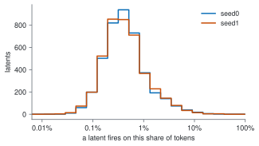
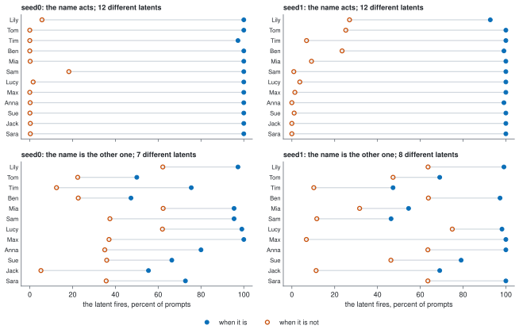
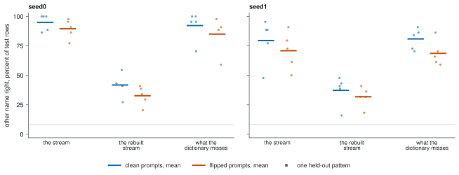

# 5. Features

Code: [`minterp/sae.py`](../minterp/sae.py) ·
Script: [`scripts/sae.py`](../scripts/sae.py) ·
Tests: [`tests/test_sae.py`](../tests/test_sae.py),
[`tests/test_features.py`](../tests/test_features.py) ·
Results: [`runs/sae/`](../runs/sae/)

[Step 4](04-circuit.md) described the model in the parts it was built
from: heads and positions. Those need not be the units in which it keeps
track of things. This step trains a dictionary that looks for such units,
judges it the way dictionaries are usually judged, and then asks the
question of this walk-through: at the place where step 4 found a head
fetching the other name, does the dictionary have a unit for it?

## A dictionary for the stream

Elhage et al. (2022) studied small ReLU networks trained on made-up data
with sparse features, and found that such a network can represent more
features than it has dimensions when few of them are present at a time.
They call it superposition. The hypothesis behind a dictionary is that the
stream of a language model is like that: each vector a sum of a few
directions out of many, more than its 384 numbers, so that no single
coordinate means anything.

A sparse autoencoder looks for the directions. It maps a stream vector to
many more numbers than the vector has, the latents, lets only a few of them
be non-zero, and maps those back to the vector:

    z = top_k(W_enc (x - b) + b_enc)         the latents: the k largest kept, if above zero
    x_hat = W_dec z + b                      the vector rebuilt from at most k directions

The code also divides `x` by one number, the stream's typical size at that
depth, before all this. The autoencoder is trained to make `x_hat` close to
`x`. Each column of `W_dec` is one direction, and a latent's value says how
much of that direction a vector contains. Bricken et al. (2023) trained one
on a one-layer transformer and found its features a more monosemantic unit
of analysis than the model's neurons. Keeping the k largest latents is the
k-sparse autoencoder, which Gao et al. (2024) apply to language models. It
sets the number of active latents directly, where the variant with a
penalty has a strength to tune.

[`sae.py`](../minterp/sae.py) is that autoencoder in a hundred lines. Its
test is superposition in miniature: vectors of 24 numbers are built as sums
of 3 directions out of 60, and the autoencoder, shown only the vectors,
finds a direction close to most of the 60.

## Training one here

```sh
uv run scripts/sae.py                 # about 90 seconds on the laptop's GPU
uv run scripts/sae.py --model seed1
```

The dictionary is trained on the stream after block 4, the block of the
fetching heads of step 4. Its training data is not the task. It is ordinary
story text: 1,024,000 stream vectors from the stories the model was trained
on, at every position. It has 4,096 latents, of which at most 32 are active
on a vector. One dictionary is trained per model, with one setting, and the
exercises say what to vary. The numbers of the latents below belong to
these two dictionaries. A run on another machine gives others.

## Judged the usual way

All on stories the dictionary did not train on.

| | seed0 | seed1 |
|---|---|---|
| variance of the stream that the rebuilt stream misses | 7.8% | 8.4% |
| the same for the best 32 fixed directions | 57% | 56% |
| latents that never fire | 0 | 0 |
| a latent fires on this share of tokens, median | 0.40% | 0.39% |
| the model's loss | 1.489 | 1.490 |
| with the rebuilt stream in place of the real one | 1.537 | 1.548 |
| with the stream replaced by its mean | 7.646 | 7.437 |
| share of the loss recovered | 99.2% | 99.0% |

Two yardsticks say what these numbers are worth. Thirty-two directions
chosen for each vector out of 4,096 miss 8% of the variance, where the best
thirty-two fixed directions miss 57%. And with the rebuilt stream in place
of the real one at every position, the model's loss rises by 3.2% and 3.9%.
The 99% is the more flattering way to say the same thing, because it is
measured against a stream replaced by its mean, which ruins the model. Gao
et al. warn about scores measured against a baseline of the same kind, a
stream set to zero.



What do the latents fire on? The script takes sixteen latents at evenly
spaced ranks of how often they fire, so that the sample is not picked by
eye, and prints the text on which each fires most. Five of the sixteen of
seed0 follow, and these five were picked: they are among the readable ones.
The token a latent fires on is in brackets.

| Latent | fires on | its strongest examples | of all its firings, on the token of its strongest example |
|---|---|---|---|
| 1526 | 1.81% of tokens | his mum what it was. [She] · He asked [her] · friend Fiona. [She] | 15% |
| 138 | 1.08% | From that [day] · From that [day] · From that [day] | 63% |
| 2028 | 0.66% | Once [upon] · Once [upon] · Once [upon] | 44% |
| 1878 | 0.38% | with the bell all [day] · played all [day] | 31% |
| 2389 | 0.17% | One [sunny] · On a beautiful [sunny] · One [sunny] | 18% |

Of the sixteen, seven in seed0 and five in seed1 have 24 or more of their
30 strongest activations on one token, and six in each have fewer than 12.
Over all 4,096 latents the first is true of 35%, in both dictionaries. The
last column shows what the strongest examples can hide. Twelve of the
thirty-two sampled latents of the two dictionaries look like one word at
their strongest, and eight of those twelve fire on that word in a minority
of their firings.

## The task: a latent for the name that acts

Now the task. At the acting name's position after block 4, the stream holds
the name that acts, which is the token there. Step 4's reading was that it
also holds the other name, fetched by a head in that block: step 2's reader
gets the other name right there on 95% and 90% of its test rows in seed0.
Does the dictionary have a latent for each?

For each of the twelve names the script picks the latent that best tells
the prompts where that name acts from the others, by how often it fires,
and likewise for the name as the other name. It also asks whether any
latent separates the two groups by the size of its activation, which is the
kind of test Gao et al. use for features they expect.



| The best latent for a name | seed0 | seed1 |
|---|---|---|
| as the name that acts: fires when it does | 97% to 100% of prompts | 93% to 100% |
| as the name that acts: fires when it does not | 0% to 18% | 0% to 27% |
| different latents for the twelve names | 12 | 12 |
| names with a latent that separates 99% of pairs or more by size | 12 | 12 |
| as the other name: fires when it is | 47% to 100% | 46% to 100% |
| as the other name: fires when it is not | 5% to 62% | 7% to 75% |
| different latents for the twelve names | 7 | 8 |
| names with a latent that fires on over 80% with and under 20% without | 0 | 1 |
| names with a latent that separates 90% of pairs by size | 3 | 2 |

For the name that acts there is a latent per name on these prompts. They
are not latents for the token alone. On stories, the token of the name
makes up between 1% and 60% of what each of them fires on in seed0, and
only two of the twelve have 24 of their 30 strongest activations on the
name's token (three in seed1).

For the other name there is a latent per name for few of the twelve. By
firing, only Max in seed1 has one. By size, Tim, Max and Jack have one in
seed0 and Max and Jack in seed1. For the other nine or ten names there is
none by either test. The best latent for Lily as the other name is also the
best for Mia and for Lucy in seed0, fires on 62% of the prompts where the
other name is not Lily, and fires on 4.1% of all story tokens.

## Kept, or missed?

No latent of its own is not the same as not there. The other name could be
spread over several latents, or it could be in the part of the stream that
the dictionary does not rebuild. At this position that part is larger than
on stories: 11% and 12% by the same yardstick as the stories' 8%, and 29%
and 30% of what differs among the task's prompts. In size it is about a
third of the stream there.

Step 2's reader can say what is where. It is fitted, as there, on four
sentence patterns and tested on the fifth, on pairs of names it has not
seen, on three inputs: the stream, the rebuilt stream, and the difference
between the two, which is what the dictionary misses. A fourth input gives
the floor: the stream with the other name averaged out of it, as defined in
the next section. The
last two columns count a guess as right if it is a name of the right kind,
where the two kinds are the six names after which the model goes on
with "She" and the six after which it goes on with "He".



| A reader fitted on | the other name right: seed0 | seed1 | a name of the right kind: seed0 | seed1 |
|---|---|---|---|---|
| the stream (step 2) | 95, 90 | 80, 71 | 98, 96 | 90, 89 |
| the rebuilt stream | 42, 33 | 37, 32 | 87, 86 | 81, 83 |
| what the dictionary misses | 92, 85 | 81, 69 | 97, 94 | 95, 92 |
| the stream with the other name averaged out | 0, 0 | 0, 0 | 51, 49 | 47, 49 |

The two numbers in a cell are clean and flipped prompts, in percent of test
rows.

**The dictionary keeps the kind of name and loses much of which name.**
From the rebuilt stream a reader names the other name on a third to two
fifths of the rows, less than half as often as from the stream, and a name
of the right kind on more than four in five, against one in two for a
reader that has nothing of the other name to go on.
From what the dictionary misses, a reader does nearly as well as from the
whole stream.

That is what can be read from each part by a reader fitted on it. What
step 2's own reader used is a different question, and its scores can be
split: they are linear, so its score on the stream is its score on the
rebuilt part plus its score on the missed part. Of the margin by which it
puts the right name above the others, 61% and 58% come from the missed part
in seed0, and 60% and 54% in seed1. More than half of what that reader went
by is in the part the dictionary does not rebuild.

By the usual measures the dictionary rebuilt the stream well. It is
trained and judged on the stream as a whole, over all of the text, and what
tells one name from another at one position is a small part of that. Gao et
al. make the general point: reconstruction and sparsity are not what a
dictionary is for, and they propose to judge one also by whether features
one expects were recovered. Here the expected feature was not recovered for
most names.

## Does the model mind?

The reader lost most of the other name. What about the model? The test is
the one of step 3: change the stream at the acting name's position and look
at the answer, and at the veto head of step 4, which reads that position
from the last one. Two changes are compared. One puts the rebuilt stream
there. The other gives a scale: it removes the other name altogether, by
giving every prompt the mean stream of the eleven prompts of its pattern
and version in which the same name acts. Those differ in the other name
only. All numbers are logits, and what the head adds is measured as in step
4, against the nine names that are none of the prompt's three.

| At the acting name's position | seed0 clean | flipped | seed1 clean | flipped |
|---|---|---|---|---|
| logit difference | +7.90 | −3.93 | +5.25 | −2.24 |
| with the rebuilt stream | +7.96 | −4.01 | +5.19 | −2.25 |
| with the other name averaged out | +7.35 | −3.21 | +4.64 | −1.60 |
| mean change per prompt, rebuilt | 0.37 | 0.38 | 0.24 | 0.24 |
| mean change per prompt, averaged out | 0.65 | 1.22 | 0.61 | 0.69 |
| the veto head adds to the other name | +0.42 | +0.52 | +0.39 | +0.44 |
| with the rebuilt stream | +0.35 | +0.42 | +0.31 | +0.35 |
| with the other name averaged out | −0.07 | 0.00 | +0.03 | +0.06 |

Taking the other name out of this position moves the mean logit difference
towards zero by 0.55 to 0.72 logits. That is what the other name at this
position is worth to the mean answer, which fits step 3, where this position
carried a tenth to a seventh of a name. Against that scale, the rebuilt
stream moves the mean by less than 0.1. The means hide some movement: a
single prompt moves by 0.24 to 0.38 on average with the rebuilt stream, a
third to three fifths of what it moves when the name is taken out. And the
veto head still adds four fifths of what it added to the other name, where
averaging takes that to zero.

So on average the model loses less than the reader did. A reader fitted on the rebuilt
stream names the other name on 42% of clean rows in seed0 where one fitted
on the stream names it on 95%. The veto head keeps four fifths of its mean
push. The two were never the same kind of thing, though. The head is not a
reader of the name: in what it writes, the other name is the largest of
the eleven names it could be on 16% to 17% of prompts, on 13% to 15% with
the rebuilt stream, and on 8% to 10% with the name averaged out. Its +0.42 is a small
push in the right direction on average.

This note's reading, as a matter of degree and no more: the dictionary
loses more of what a fitted reader goes by than of what the model's own
head goes by. Step 2 warned that a reader's score is not a measure of what
the model uses. Here the two were measured side by side and differ.

With the rebuilt stream at every position the model still does the task:
the right name is ahead on 98% of clean and 92% of flipped prompts in seed0
(100% and 85% without) and on 96% and 78% in seed1 (95% and 76%). In seed0
both versions shift towards the first name, the clean prompts from +7.90 to
+7.31 and the flipped ones from −3.93 to −5.51, so that the mean of the two
versions, which is the lean to the second name, falls from 1.98 to 0.90.
This note has not traced why. In seed1 it stays where it was, 1.50 and
1.40.

## The same in both models, and not

The same: what the dictionary misses on stories (7.8% and 8.4%) and at the
acting name (29% and 30% of the variance among the prompts); a latent per
name for the name that acts; none for most names as the other name; a
reader on the rebuilt stream at 32% to 42% for the name and above 80% for
its kind; more than half of step 2's reader's margin in the missed part;
and a veto head that keeps four fifths of what it adds to the other name.
Not the same: how well the other name is read from the stream to begin with
(95 and 90 against 80 and 71), so the fall is larger in seed0; and what the
rebuilt stream at every position does to the lean, which moves by 1.09
logits in seed0 and by 0.11 in seed1.

## What this does not show

- **That another dictionary would do the same.** One width, one number of
  active latents, one training run per model, one depth. A wider
  dictionary, or one trained only at the positions that matter, may have a
  latent for each name as the other name. The exercises start there.
- **What the latents mean.** Sixteen latents were described by their eight
  strongest examples. The last column of their table shows how little that
  says about the rest of what a latent fires on.
- **Which latents the mechanism uses.** That the model loses little with
  the rebuilt stream says the dictionary keeps most of what is needed here,
  not in which latents.
- **That a second run would find the same latents.** Step 8 trains a
  second dictionary and compares.

Step 6 starts from the third point: which latents does the answer depend
on?

## Exercises

1. Train a dictionary with 16,384 latents, and one with 64 active latents.
   Does either have a latent per name for the other name? Does the reader
   on the rebuilt stream recover?
2. Train a dictionary only on the stream at the positions of names in the
   stories. What changes, and what does that say about the first point
   above?
3. The other variant keeps all latents and adds a penalty on their sum to
   the loss. Implement it. How does the penalty's strength trade the
   variance missed against the number of active latents?
4. For three of the sixteen sample latents, look at the weakest tenth of
   their activations instead of the strongest. What do they fire on there?
5. The reader on the rebuilt stream gets the kind of name right far more
   often than the name. Is there a latent for the kind? The results list
   which names the model follows with "She".
6. In seed0, step 2 could read the acting name at the last position after
   block 3 on 65% and 70% of its test rows. Train the dictionary after block
   3 and repeat the reader test there. Is that kept?

## References

- Elhage et al. (2022), [Toy Models of Superposition](https://transformer-circuits.pub/2022/toy_model/index.html), Transformer Circuits Thread. Small ReLU networks on synthetic data that represent more features than they have dimensions when the features are sparse.
- Bricken et al. (2023), [Towards Monosemanticity: Decomposing Language Models With Dictionary Learning](https://transformer-circuits.pub/2023/monosemantic-features/index.html), Transformer Circuits Thread. A sparse autoencoder on the MLP of a one-layer transformer, and its features as a more monosemantic unit than neurons.
- Gao et al. (2024), [Scaling and evaluating sparse autoencoders](https://arxiv.org/abs/2406.04093). The k-sparse autoencoder (which they credit to Makhzani and Frey, 2013) applied to language models, and ways to judge a dictionary other than by reconstruction and sparsity.
